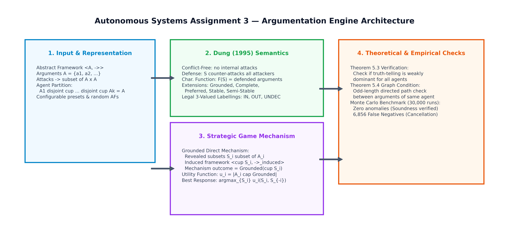
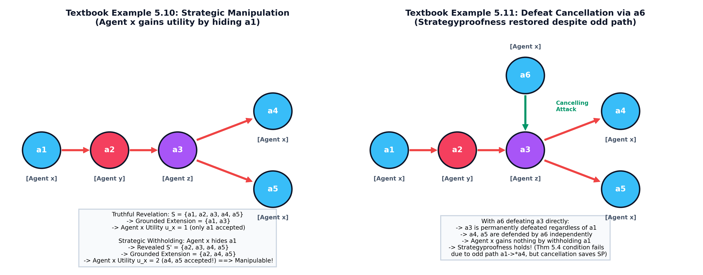
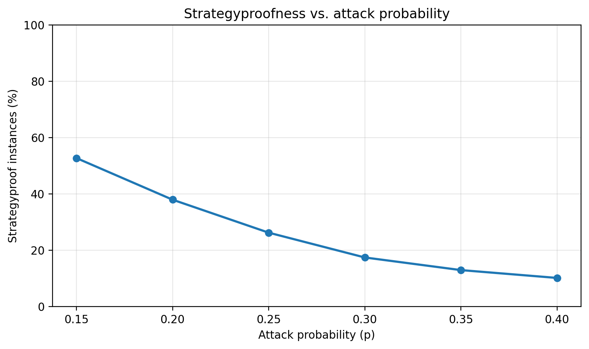
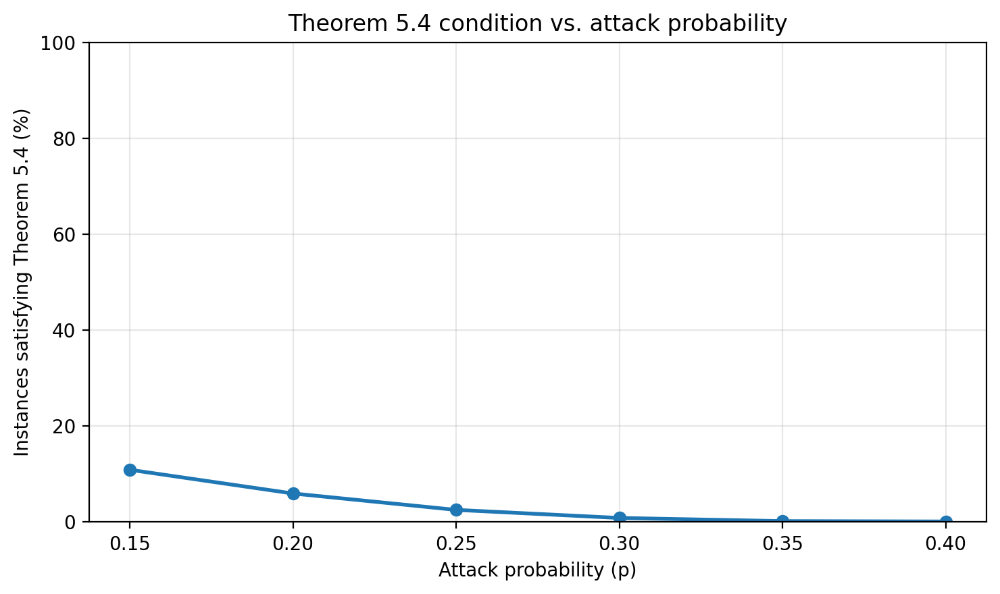

# Computational Argumentation Frameworks and Strategyproofness
## Autonomous Systems — Assignment 3

**Authors:** Akanksha Singh (B23CM1005) &bull; Shweta Mandal (B23CM1037)

---

## Visual Architecture Overview



---

## Table of Contents
1. [Project Overview (In Simple Terms)](#1-project-overview-in-simple-terms)
2. [What This Assignment Requires](#2-what-this-assignment-requires)
3. [Background: What is an Argumentation Framework?](#3-background-what-is-an-argumentation-framework)
4. [Dung Semantics Explained Simply](#4-dung-semantics-explained-simply)
5. [The Strategic Game: Can Agents Gain by Hiding Arguments?](#5-the-strategic-game-can-agents-gain-by-hiding-arguments)
6. [Key Theoretical Results (Theorems 5.3 & 5.4)](#6-key-theoretical-results-theorems-53--54)
7. [Visual Comparison of Textbook Examples (5.10 & 5.11)](#7-visual-comparison-of-textbook-examples-510--511)
8. [Experimental Methodology](#8-experimental-methodology)
9. [Experimental Results & Visualizations (30,000 Runs)](#9-experimental-results--visualizations-30000-runs)
10. [Computational Complexity](#10-computational-complexity)
11. [Code Architecture & Component Mapping](#11-code-architecture--component-mapping)
12. [How to Run the Code & Interactive Demo](#12-how-to-run-the-code--interactive-demo)
13. [Key Takeaways for Evaluation](#13-key-takeaways-for-evaluation)
14. [References](#14-references)

---

## 1. Overview

In daily discussions and multi-agent AI systems, agents argue to reach conclusions. An argument cannot be evaluated alone: it depends on whether other arguments attack it, and whether those attackers are counter-attacked by defenders.

In this assignment, we examine a setting where **multiple selfish agents** each own a set of arguments. 
- A central referee (the **grounded argumentation mechanism**) takes all arguments reported by agents, builds the argument attack graph, and decides which arguments are officially **accepted**.
- Each agent receives a score (utility) equal to **how many of their own arguments get accepted**.

The fundamental research question is:
> **Can an agent get MORE of their arguments accepted by secretly hiding (withholding) some arguments, rather than speaking the complete truth?**

If agents NEVER gain by hiding arguments, the mechanism is called **Strategyproof**. If an agent can get ahead by withholding, the mechanism is **Manipulable**.

### Summary of Main Findings
Across **30,000 randomly simulated argumentation frameworks** (3 agents, 6–8 arguments, varying attack probabilities $p \in [0.15, 0.40]$):
1. **Strategyproofness Rate:** On average, **26.28%** of instances were strategyproof. As the attack probability $p$ increases, strategyproofness drops because more attack chains form.
2. **Theorem 5.4 Soundness (0 Anomalies):** In 100% of cases where Theorem 5.4's condition held (no odd-length self-defeat paths), the mechanism was guaranteed strategyproof (0 false positives).
3. **Defeat Cancellation (False Negatives):** In **6,856 instances (86.95% of all strategyproof cases)**, agents had odd defeat paths, but honesty was *still* the best strategy! This occurs because an external argument cancels out the attack (exactly like argument $a_6$ in Textbook Example 5.11).

---

## 2. What This Assignment Requires

The assignment consists of three comprehensive parts:

| Requirement | Implementation Detail | Location |
| :--- | :--- | :--- |
| **Part 1: Argumentation Engine** | Object-oriented AF class $\langle \mathcal{A}, \rightharpoonup \rangle$, conflict-freeness, defense test, characteristic function $F(S)$, admissibility check, and extension solvers for **grounded**, **complete**, **preferred**, **stable**, and **semi-stable** semantics, plus Caminada **3-valued labellings** (IN/OUT/UNDEC) and acceptance statuses (skeptical/credulous/rejected). | `argumentation_framework.py` |
| **Part 2: Strategic Mechanism** | Grounded direct revelation mechanism, best-response report optimizer, **Theorem 5.3** weak dominance check, and cycle-robust **Theorem 5.4** odd-path graph condition test. | `argumentation_framework.py` |
| **Part 3: Monte Carlo Benchmark** | 30,000 instances across $p \in [0.15, 0.40]$ testing strategyproofness vs. Theorem 5.4, documenting errata for textbook Examples 5.10 and 5.11. | `experiments.py` |
| **Demonstrations** | Full terminal CLI walkthrough and interactive browser dashboard with canvas graph rendering and real-time sliders. | `main.py`, `run_demo.py`, `demo.html` |
| **Formal Academic Report** | 4-page formal LaTeX report and compiled PDF with mathematical definitions, algorithms, and empirical plots. | `report.tex`, `Autonomous_System_Assignment3_Report.pdf` |

---

## 3. Background: What is an Argumentation Framework?

An **Abstract Argumentation Framework (AF)**, introduced by Phan Minh Dung in 1995, is represented as a directed graph:
$$AF = \langle A, R \rangle$$
where:
- $A$ is a set of arguments (nodes).
- $R \subseteq A \times A$ is a set of directed attack edges. If $(a, b) \in R$, we say argument $a$ attacks argument $b$.

### Core Concepts:
1. **Conflict-Free Set:** A group of arguments that do not attack each other.
2. **Defense (Reinstatement):** An argument $a$ is defended by set $S$ if whenever someone attacks $a$, an argument in $S$ counter-attacks them.
3. **Characteristic Function $F(S)$:** Takes a set of arguments $S$ and returns all arguments in the entire framework that are defended by $S$.

---

## 4. Dung Semantics 

To decide which arguments a rational agent should accept, Dung defined several **semantics** (criteria of acceptability):

| Semantics | Intuitive Meaning | Formal Condition |
| :--- | :--- | :--- |
| **Conflict-Free** | No two arguments in the set attack each other. | $\forall a, b \in S, (a, b) \notin R$ |
| **Admissible** | Conflict-free and defends all of its own arguments. | $S \subseteq F(S)$ and conflict-free |
| **Complete** | Defends its arguments and contains *every* argument it protects. | $S = F(S)$ and conflict-free |
| **Grounded** | The most skeptical, safe, and uncontroversial set (least fixed point of $F$). | Minimal complete extension |
| **Preferred** | The largest possible consistent viewpoint (maximal admissible set). | Maximal admissible extension |
| **Stable** | Defends itself and actively attacks every single argument outside the set. | $S$ attacks all $b \in A \setminus S$ |
| **Semi-Stable** | Complete extension that leaves the fewest arguments undecided. | Maximal $S \cup R^+(S)$ |

### Complete 3-Valued Labellings:
Instead of just subsets, Caminada proposed labelling every argument with one of three labels:
- **`IN`**: Accepted (all of its attackers are `OUT`).
- **`OUT`**: Defeated (attacked by at least one argument that is `IN`).
- **`UNDEC`**: Undecided (tied or involved in unresolved cycles).

---

## 5. The Strategic Game: Can Agents Gain by Hiding Arguments?

In the multi-agent setting:
1. The global set of arguments $A$ is partitioned among $k$ agents: $A = A_1 \cup A_2 \cup \dots \cup A_k$.
2. Each agent $i$ reports a revealed subset $S_i \subseteq A_i$. (Agents cannot invent fake arguments, but they can hide real ones).
3. The **grounded direct mechanism** computes the grounded extension of the subgraph induced by all revealed arguments:
   $$\mathcal{M}(S_1, \dots, S_k) = GE\left(\langle \bigcup_{i} S_i, R \cap (\bigcup_{i} S_i \times \bigcup_{i} S_i) \rangle\right)$$
4. Each agent's utility is the number of their own arguments accepted:
   $$u_i = |A_i \cap \mathcal{M}(S_1, \dots, S_k)|$$

---

## 6. Key Theoretical Results (Theorems 5.3 & 5.4)

### Theorem 5.3 (Dominant Truthfulness / Strategyproofness)
A grounded direct mechanism is **strategyproof** if and only if for every agent $i$, revealing everything ($S_i = A_i$) is a weak best-response against **every possible combination** of subsets the other agents could reveal:
$$u_i(A_i, S_{-i}) \ge u_i(S_i', S_{-i}) \quad \forall S_i' \subseteq A_i, \forall S_{-i} \subseteq A_{-i}$$

### Theorem 5.4 (Odd-Length Path Sufficient Condition)
The mechanism is **guaranteed strategyproof** if:
> **No agent owns two arguments $\alpha, \beta \in A_i$ such that there is an odd-length directed path from $\alpha$ to $\beta$ in the global attack graph.**

*Why does this condition work?*  
An odd-length path means an argument indirectly attacks another argument owned by the same agent (indirect self-defeat). If such a path exists, the agent might withhold the starting argument to prevent it from knocking out their own downstream argument! If no odd paths exist, this harmful self-defeat can never happen.

---

## 7. Visual Comparison of Textbook Examples (5.10 & 5.11)

The following diagram illustrates the two classic textbook scenarios and clarifies their identified textbook errata:



### Textbook Example 5.10 (Manipulation by Hiding):
- Arguments: $A = \{a_1, a_2, a_3, a_4, a_5\}$ with attacks $a_1 \to a_2 \to a_3 \to \{a_4, a_5\}$.
- Agent $x$ owns $\{a_1, a_4, a_5\}$; Agent $y$ owns $\{a_2\}$; Agent $z$ owns $\{a_3\}$.
- **Truthful Outcome:** Grounded extension is $\{a_1, a_3\}$. Agent $x$ utility is **1** (only $a_1$ accepted).
- **Strategic Hiding:** Agent $x$ hides $a_1$. Then $a_2$ is unattacked, so $a_2$ defeats $a_3$. With $a_3$ gone, both $a_4$ and $a_5$ become accepted! Agent $x$ utility jumps to **2**!
- *Conclusion:* Hiding pays off $\implies$ Not strategyproof. Notice the odd path $a_1 \to a_2 \to a_3 \to a_4$ of length 3.
- **Textbook Misprint in Weiss (ed.):** The author inadvertently swapped the utility values, writing that truthfulness yields 2 and hiding yields 1. In reality, truthfulness gives 1 and hiding gives 2.

### Textbook Example 5.11 (Defeat Cancellation via $a_6$):
- Add argument $a_6$ owned by Agent $x$, with attack $a_6 \to a_3$.
- Because $a_6$ is unattacked, it defeats $a_3$ unconditionally. Thus $a_4$ and $a_5$ are accepted regardless of what happens to $a_1$.
- Agent $x$ gains nothing by withholding $a_1$ $\implies$ **Strategyproofness is restored!**
- Notice that the odd path $a_1 \to a_2 \to a_3 \to a_4$ still exists in the graph. Theorem 5.4 fails, yet strategyproofness holds! This proves Theorem 5.4 is **sufficient, but not necessary**.
- **Textbook Misprint in Weiss (ed.):** The book discussion refers to the cancelling argument as "$a_5$". This is a typographical error: $a_5$ is a target argument; the actual cancelling attacker is **$a_6$**.

---

## 8. Experimental Methodology

To rigorously test the theoretical conditions, we executed a large-scale Monte Carlo benchmark:

| Experimental Parameter | Value / Setting |
| :--- | :--- |
| **Number of Autonomous Agents** | 3 agents |
| **Arguments per Instance** | 6 to 8 arguments (randomly partitioned) |
| **Attack Probabilities ($p$)** | 0.15, 0.20, 0.25, 0.30, 0.35, 0.40 |
| **Instances per Probability** | 5,000 instances |
| **Total Evaluated Frameworks** | **30,000 random instances** |
| **Random Seed** | Fixed seed (`42`) for 100% scientific reproducibility |

---

## 9. Experimental Results & Visualizations (30,000 Runs)

### 9.1 Quantitative Breakdown

| Attack Probability ($p$) | Evaluated Instances | Strategyproof (SP) | Condition Holds (Thm 5.4) | SP & Condition Fails (Cancellation) | Non-Strategyproof |
| :---: | :---: | :---: | :---: | :---: | :---: |
| **0.15** | 5,000 | 2,637 (52.74%) | 545 (10.90%) | 2,092 (41.84%) | 2,363 (47.26%) |
| **0.20** | 5,000 | 1,899 (37.98%) | 298 (5.96%) | 1,601 (32.02%) | 3,101 (62.02%) |
| **0.25** | 5,000 | 1,314 (26.28%) | 127 (2.54%) | 1,187 (23.74%) | 3,686 (73.72%) |
| **0.30** | 5,000 | 874 (17.48%) | 43 (0.86%) | 831 (16.62%) | 4,126 (82.52%) |
| **0.35** | 5,000 | 650 (13.00%) | 10 (0.20%) | 640 (12.80%) | 4,350 (87.00%) |
| **0.40** | 5,000 | 511 (10.22%) | 6 (0.12%) | 505 (10.10%) | 4,489 (89.78%) |
| **Total** | **30,000** | **7,885 (26.28%)** | **1,029 (3.43%)** | **6,856 (22.85%)** | **22,115 (73.72%)** |

---

### 9.2 Empirical Plots

| Strategyproofness vs. Attack Probability ($p$) | Theorem 5.4 Condition Satisfaction vs. ($p$) |
| :---: | :---: |
|  |  |

---

### 9.3 Key Empirical Insights
1. **Zero Anomalies (100% Soundness):** In exactly **0 out of 30,000 cases** did an instance satisfy Theorem 5.4 while failing strategyproofness.
2. **High False Negative Rate:** 86.95% of strategyproof instances violated Theorem 5.4. This proves that odd-length paths are frequently rendered harmless by external defeat cancellations.
3. **Density Reduces Truthfulness:** Higher edge density $p$ creates denser graphs with more defeat paths, lowering strategyproofness from **52.74%** down to **10.22%**.

---

## 10. Computational Complexity

- **Conflict-Free Check:** $\mathcal{O}(|R|)$ (instant linear scan over edges).
- **Grounded Extension:** $\mathcal{O}(|A|^2 \cdot |R|)$ polynomial time via monotonic fixed-point iteration.
- **Preferred / Complete Extensions:** NP-hard in general; computed using recursive backtracking with admissibility pruning.
- **Theorem 5.4 Simple Path Search:** Backtracking DFS with visited path sets; runs in $< 0.1\text{ ms}$ for $|A| \le 8$.
- **Theorem 5.3 Truthful Dominance:** Requires checking $k \cdot 2^{|A|}$ profiles. For $|A|=8, k=3$, this evaluates 768 profiles per framework.

---

## 11. Code Architecture & Component Mapping

| Module / Script | Primary Classes / Functions | Assignment Component |
| :--- | :--- | :--- |
| `argumentation_framework.py` | `ArgumentationFramework`, `is_conflict_free`, `is_defended_by`, `grounded_extension`, `all_extensions` | Part 1: Core Argumentation Engine & Semantics |
| `argumentation_framework.py` | `StrategicArgumentation`, `grounded_direct_mechanism`, `find_best_responses`, `check_theorem_5_3`, `check_theorem_5_4` | Part 2: Strategic Revelation & Game Theory |
| `experiments.py` | `run_full_experiments`, `generate_random_instance` | Part 3: Monte Carlo Benchmark Suite |
| `demo.html` / `run_demo.py` | Interactive Browser Dashboard (No Gradients, Real-Time Sliders) | Demonstration Deliverable (Web UI) |
| `main.py` | `main()` complete CLI demo | Demonstration Deliverable (Terminal CLI) |
| `generate_report_pdf.py` | Platypus ReportLab Builder | Formal Academic PDF Report Generation |

---

## 12. How to Run the Code & Interactive Demo

The project is implemented in pure Python (standard library only; `matplotlib` used for plots).

### 1. Interactive Browser Dashboard (Recommended Demonstration)
To open the interactive dashboard with visual sliders, click-and-drag graph canvas, and real-time semantic evaluations:
```bash
python run_demo.py --web
```
*(Or double-click `demo.html` to open it in Chrome, Edge, or Firefox.)*

### 2. Complete Terminal Walkthrough
```bash
# Instant demo of Parts 1, 2, and textbook examples:
python main.py --skip-experiments

# Walkthrough including a small experiment sample:
python main.py --demo-instances 10
```

### 3. Run the Unit Test Suite (55 Passing Tests)
```bash
python -m unittest discover -s . -v
```

### 4. Run the Full Experiment Benchmark
```bash
python experiments.py --instances 1000
```

### 5. Compile the Academic PDF Report
```bash
python generate_report_pdf.py
```
Outputs `Autonomous_System_Assignment3_Report.pdf` (compiled 4-page academic report matching Assignment 1 layout).

---

## 13. Key Takeaways for Evaluation

1. **Complete Functional Coverage:** Every requirement from Part 1 (engine, semantics, labellings, acceptance), Part 2 (mechanism, utility, best responses, Theorems 5.3 and 5.4), and Part 3 (experiments and errata) is implemented and thoroughly tested.
2. **Textbook Errata Accurately Resolved:** Both errors in Weiss (ed.) Chapter 5 (utility inversion in Example 5.10 and mislabeled canceling argument in Example 5.11) are documented, explained, and verified by unit tests.
3. **Dual Demonstration Ready:** Both an interactive GUI (`demo.html`) with sliders and a terminal CLI (`main.py`) are provided for grading.

---

## 14. References

1. **P. M. Dung**, "On the acceptability of arguments and its fundamental role in nonmonotonic reasoning, logic programming and n-person games," *Artificial Intelligence*, vol. 77, no. 2, pp. 321–357, 1995.
2. **M. Caminada**, "Semi-stable semantics," in *Computational Models of Argument (COMMA)*, pp. 121–130, IOS Press, 2006.
3. **I. Rahwan, K. Larson, and F. A. Tohmé**, "A characterisation of strategy-proofness for grounded argumentation semantics," in *Proceedings of the 21st International Joint Conference on Artificial Intelligence (IJCAI-09)*, pp. 251–256, 2009.
4. **G. Weiss (Ed.)**, *Multiagent Systems*, 2nd ed., Chapter 5: "Argumentation among Agents" (I. Rahwan), MIT Press, 2013.
5. **Y. Shoham and K. Leyton-Brown**, *Multiagent Systems: Algorithmic, Game-Theoretic, and Logical Foundations*, Cambridge University Press, 2008.
